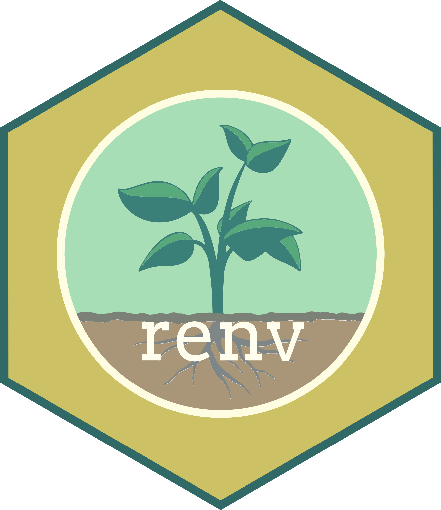
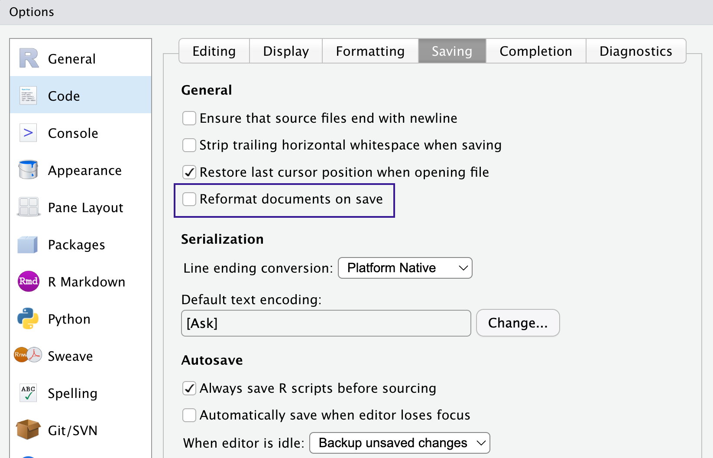

# A confession {.s-green}

## Why now? {.s-green}

I am leaving the team in a few months.

. . .

Six years of telling you about `renv`, `pins`, tests, `.gitignore`.

. . .

You nodded. Politely.

::: notes
Be honest and light. The point: I know you know the problems. I will not lecture. This is a legacy talk: one repo you can copy, with the reasons attached.
:::

## The deal {.s-green}

- You already know reproducibility matters
- You do not want a new religion
- So: **a folder you download**, with reasons, and each piece optional

. . .

Today: I boiled it down to just one repo, `project-skeleton/`.

::: notes
Low friction is the design goal. Everything shown today is in the repo, and the repo docs mirror the section names of this presentation.
:::

# Why this structure {.s-blue}

## Does this look familiar? {.s-blue}

- Which folder holds the *real* data?
- Which package versions produced figure 3?
- What is `analysis_final_v2_NEW_use-this.R`?
- Who ran which script, and in what order?

. . .

Three months later, the "who" is you.

::: notes
Ask for a show of hands. Humour: the person who cannot reproduce your result is future you, with no memory.
:::

## What it looks like without a structure {.s-blue}

```
my_project/
├── analysis_final_v2_NEW_use-this.R
├── analysis_final.R
├── data_old/
├── data_new/
│   └── fish_FINAL_cleaned(1).csv
├── figure3_try2.png
├── Untitled1.R
└── notes.txt
```

. . .

Now the same project, with a place for everything:

```
fish_survey/
├── data/       ├── scripts/    ├── R/
├── outputs/    ├── tests/      └── README.md
```

## {.s-blue}

::: {.statement}
"Future you is a collaborator<br>who never answers e-mails"
:::

## What the skeleton gives you {.s-blue}

| Pain | Answer in the repo |
|---|---|
| Where is the data? | `data/` plus `pins` for shared data |
| Which package versions? | `renv.lock` |
| What did I assume about the data? | checks in `scripts/`, helpers in `R/`, tests in `tests/` |
| What goes into git? | a commented `.gitignore` |
| What is this project? | `README.md` |

# The folder structure {.s-yellow}

## Simple and minimal {.s-yellow}

```
project-skeleton/
├── data/
├── R/
├── scripts/
├── outputs/
├── tests/
├── docs/
├── README.md
└── PROJECT_STRUCTURE.md
```

Each folder has a short README saying what goes in it.

## What goes where {.s-yellow}

| Folder | Content |
|---|---|
| `data/` | inputs (mostly **not** tracked, see later) |
| `R/` | **functions**, sourced by scripts and tests |
| `scripts/` | numbered scripts that run in order, **with your data checks** |
| `outputs/` | figures, tables, models: recreated by scripts |
| `tests/` | `testthat` tests of the **functions** in `R/` (not of your data) |
| `docs/` | notes, images, anything for humans (and agents) |

::: notes
Why simple: the colleague repo we looked at had Analysis-Code/, code/, data/raw_data. Everybody invents a layout; the cost is onboarding time. Here you can explain it in one slide. Key rule to stress: tests/ tests functions. Data is checked throughout the scripts, where the data flows.
:::

## Start in five minutes {.s-yellow}

1. Download the repo as a **zip**, unzip, rename the folder
2. Open the `.Rproj` in RStudio
3. Raw data in `data/raw/`, edit the numbered scripts
4. Fill in `CITATION.cff` and `LICENSE`
5. `renv::init()` now or wait until the end, before you share the code
6. Read `PROJECT_STRUCTURE.md`, then **delete it**

No git history to inherit: `git init` when you are ready, or forced.

## Showing the tree {.s-yellow}

`README.md` shows the tree of **your** project, so a newcomer finds their way. For example:

```
fish_survey/
├── fish_survey.Rproj
├── README.md
├── R/
│   ├── check_data.R
│   └── plot_abundance.R
├── scripts/
│   ├── 1_download.R
│   ├── 2_wrangle.R
│   └── 3_analyse.R
├── data/
├── outputs/
└── tests/testthat/
    ├── test-check_data.R
    └── test-plot_abundance.R
```

Print yours with `fs::dir_tree()` and paste it in.

## Two files, two jobs {.s-yellow}

:::: {.columns}

::: {.column width="48%"}
**`README.md`**

**Yours.** Rewrite it: what is *your* project, how to run it, where is the tree.
:::

::: {.column width="4%"}
:::

::: {.column width="48%"}
**`PROJECT_STRUCTURE.md`**

**Mine, for your information only.** The reasons behind the skeleton, the same sections as this talk. Read it, then **delete it**.
:::

::::

Also in the root: the `.Rproj`, `.gitignore`, `.Rprofile`, `CITATION.cff`, `LICENSE`.

# What to track and what to ignore {.s-green}

## Track what you wrote, ignore the rest {.s-green}

:::: {.columns}

::: {.column width="48%"}
::: {.box .box-yes}
**Tracked**

- scripts (`R/`, `scripts/`)
- `renv.lock`
- `tests/`
- READMEs, docs
- small reference tables
- templates
:::
:::

::: {.column width="4%"}
:::

::: {.column width="48%"}
::: {.box .box-no}
**Ignored**

- raw and large data
- `outputs/` (recreated)
- `renv/library/`
- `.Rproj.user/`, `.Rhistory`
- `.DS_Store`
- credentials, tokens
:::
:::

::::

::: {.rule}
Track what you wrote. Ignore what the code can recreate or what is private.
:::

::: notes
This is the slide to leave on screen during questions. Two questions decide every file: can the code recreate it? is it private? If yes to either, ignore.
:::

## Common traps {.s-green}

| Trap | Why it hurts | Fix |
|---|---|---|
| Data committed by accident | repo gets huge, history keeps it forever | ignore `data/`, use `pins` |
| `.Rhistory`, `.RData` | personal, noisy, can hold secrets | ignore, never save workspace |
| `.DS_Store` | macOS litter in every folder | ignore (also globally) |
| Secrets in scripts | public on first push | `.Renviron`, ignored |
| `renv/library/` committed | huge, machine specific | ignore |
| `renv.lock` **not** committed | the whole point of renv is lost | **track it** |

::: notes
The renv.lock one is the most common mistake: people ignore the whole renv folder out of caution and lose the lockfile. The lockfile is a text file, small, and is the record of versions. Also: once committed, data stays in the history even after deletion.
:::

## A commented `.gitignore` {.s-green}

```
# Data: recreated or shared via pins, not stored in git
data/*
!data/README.md

# Outputs: recreated by scripts
outputs/*
!outputs/README.md

# R session litter
.Rhistory
.RData
.Rproj.user/

# renv: track renv.lock, ignore the library
renv/library/
```

The file in the repo explains each block.

# When your data lives outside the repo: pins {.s-pins}

{.sec-logo}

## One copy, one name {.s-pins}

Data lives where it makes sense for the team. The repo only knows its **name**.

```{r}
#| label: pins-folder
board <- pins::board_folder(path = "/Volumes/synthesis/pins_group")

pins::pin_write(board = board, x = fish_clean, name = "fish_survey")
fish <- pins::pin_read(board = board, name = "fish_survey")
```

Shared drive, same code on laptop, server and cluster. Versions come free.

## Alone? Use a local board {.s-pins}

```{r}
#| label: pins-local
board <- pins::board_local()

pins::pin_write(board = board, x = fish_clean, name = "fish_survey")
pins::pin_read(board = board, name = "fish_survey")
```

Data stays out of git, and no path with your user name inside.

. . .

In depth: my May 2026 group meeting talk on `pins` (2026-05-13): [github.com/AlbanSagouis/pins_presentation](https://github.com/AlbanSagouis/pins_presentation)

# Reproducible packages with renv {.s-renv}

{.sec-logo}

## The problem {.s-renv}

- R keeps all packages in **one large library**
- R does not monitor which packages a project needs
- We generally do not save package names and versions

. . .

A script that ran in 2024 may not run today.

## The solution {.s-renv}

- `renv` builds a **separate library** per project
- installs the packages you use, and only those
- stores their **version numbers** in `renv.lock`

```{r}
#| label: renv-workflow
renv::init()      # once, at the start
renv::snapshot()  # after installing something new
renv::restore()   # on another machine, or in two years
```

## The quick and dirty way {.s-renv}

It just works...

. . .

You are finally done with this paper.

The editor asks you to publish the code on Zenodo.

```{r}
#| label: renv-quick
renv::init()
```

Commit `renv.lock`. Done.

::: notes
Pragmatic message: you do not need to start with renv on day one. Doing it at the end still saves reviewers. The skeleton's .Rprofile only activates renv, nothing personal.
:::

## Reviving an old project {.s-renv}

No `renv.lock`, but you remember **when it last worked**?

```{r}
#| label: renv-checkout
renv::init(bare = TRUE)                  # an empty project library
renv::checkout(
  date = "2023-02-08",                   # the day it last worked
  actions = c("snapshot", "restore")     # install them, write renv.lock
)
```


. . .

Mind the **R version** too: 2023 packages, 2023 R.

::: notes
renv::checkout() with a date uses Posit Public Package Manager snapshots. By default it covers every package the project uses (found by renv::dependencies()). Docs: rstudio.github.io/renv/reference/checkout.html. I have not tried this on a really old project yet: say so.
:::

# Testing your data with testthat and checkmate {.s-testthat}

{.sec-logo}

## Written-down expectations {.s-testthat}

You already have expectations about your data. They live in your head.

. . .

Write them down, at three points:

1. **Input**: the file you read is what you think it is
2. **Wrangling**: joins did not duplicate rows
3. **Output**: values are in a plausible range

## Two tools, two places {.s-testthat}

| | `checkmate` | `testthat` |
|---|---|---|
| Checks | your **data** | your **functions** |
| Lives in | `scripts/` (and inside functions) | `tests/testthat/` |
| Runs | every time the script runs | when you ask |
| Fails by | stopping the script | reporting a failed test |

`testdat` extends this for data frames, if you want more.

## Data checks live in your scripts {.s-testthat}

```{r}
#| label: checks-in-scripts
# scripts/2_wrangle.R
source(file = fs::path("R", "check_data.R"))

raw <- utils::read.csv(file = fs::path("data", "raw", "fish.csv"))

# 1. At the door
raw |>
  check_dataset(required_columns = c("id", "site_id"), id_column = "id")

# 2. After the join (next slide)
processed <- inner_join(x = raw, y = sites, by = join_by(site_id), ...)

# 3. On the way out
checkmate::assert_data_frame(x = processed, nrows = nrow(raw))
checkmate::assert_numeric(x = processed[["abundance"]], lower = 0, any.missing = FALSE)
```

## Joins: be explicit, be intentional {.s-testthat}

```{r}
#| label: explicit-join
library(dplyr)

processed <- inner_join(
  x = raw,
  y = sites,
  by = join_by(site_id),
  relationship = "many-to-one",           # a duplicated site would multiply rows: stop
  unmatched = c(x = "error", y = "drop")  # a row without a site: stop. Unused sites: drop on purpose
)
```

. . .

Every argument is a **decision**. Writing them makes you think about the join, and saves you writing a test for it.

::: notes
This is the spirit of my r-code-style skill: relationship and unmatched default to silence, and both failure modes (duplicated keys multiply rows, missing keys fill with NA) corrupt a result without an error. Being explicit turns them into loud failures at the join.
:::

## testthat tests your functions {.s-testthat}

`R/check_data.R` has `check_dataset()`. `tests/testthat/test-check_data.R` tests **it**:

```{r}
#| label: testthat-example
testthat::test_that("check_dataset rejects duplicated ids", {
  bad <- data.frame(id = c(1, 1), site = c("a", "b"))
  testthat::expect_error(
    check_dataset(x = bad, required_columns = "site", id_column = "id")
  )
})
```

Run **all** tests in the folder with:

```{r}
#| label: run-all-tests
testthat::test_dir("tests/testthat")
```

# Formatting with air {.s-blue}

## One style, automatically {.s-blue}

::: panel-tabset

### Before

```r
1+2:3*(4/5)

left_join <- function(x, y, by = NULL, copy = FALSE, suffix = c(".x", ".y"), ..., keep = NULL) {
  Do something
}
```

### After

```r
1 + 2:3 * (4 / 5)

left_join <- function(
  x,
  y,
  by = NULL,
  copy = FALSE,
  suffix = c(".x", ".y"),
  ...,
  keep = NULL
) {
  Do something
}
```

:::

[Air](https://posit-dev.github.io/air/) is a fast formatter for R.

## Use air in RStudio, on save {.s-blue}

{width="55%"}

Set air as the external formatter (Code, Formatting), then tick **Reformat documents on save**.

::: notes
Install the air command line tool first (posit-dev.github.io/air/editors.html). In RStudio: Tools, Global Options, Code, Formatting, Code formatter: External, Reformat command: {path/to/air} format. The screenshot is from my October 2025 group meeting on publishing code.
:::

## Automatic on every commit {.s-blue}

Running `air` and the linter `jarl` on every commit is a job for a git hook: see the `githooks` branch, next section.

# Optional add-on branches {.s-yellow}

## Three branches, three extras {.s-yellow}

Each branch forks from `main` and adds one thing. Take only what you want.

| Branch | What it adds |
|---|---|
| `githooks` | pre-commit and pre-push checks (`air`, `jarl`, tests) |
| `zenodo` | archive a release and get a DOI, badge in the README |
| `website` | Quarto website, published with GitHub Pages |

::: notes
Say clearly: main is complete without these. Each branch changes only a few files, so `git diff main..<branch>` shows exactly what it adds.
:::

# Git hooks {.s-green}

## Checks that run on every commit {.s-green}

Git hooks are scripts git runs for you. But `.git/hooks` is **never tracked**, so nobody receives your hooks.

. . .

The `githooks` branch keeps them in a tracked folder and switches them on with one line:

```{.bash}
git config core.hooksPath .githooks
```

::: notes
This is the reason the branch exists at all. Without the tracked folder, every colleague would have to copy files by hand.
:::

## What the hooks do {.s-green}

| Hook | Runs | Checks |
|---|---|---|
| `pre-commit` | before each commit | `air format --check`, `jarl check`, tests |
| `pre-push` | before each push | tests |

- No `air` or `jarl` installed? A warning, and that check is skipped. Nobody is blocked.
- In a hurry? `git commit --no-verify` skips the hooks once.

::: notes
Tested for real: badly formatted file blocked, clean file passes, missing tools skip, failing test blocks. Not tested: a real git push, Windows. air ignores .qmd files at the moment.
:::

# Archiving with Zenodo {.s-blue}

## A GitHub repo is not an archive {.s-blue}

A repo can be renamed, changed or deleted. A **DOI** is permanent and citable.

. . .

1. Log in to Zenodo with GitHub and switch the repository on
2. Fill the placeholders in `CITATION.cff`
3. Create a GitHub release: Zenodo archives it and mints the DOI
4. Paste the DOI badge in the README

::: notes
Do it when the paper is submitted, not before. Zenodo has a sandbox (sandbox.zenodo.org) for a trial run. If a .zenodo.json exists, Zenodo uses only that and ignores CITATION.cff.
:::

## Before the release {.s-blue}

- `renv.lock` committed and tests passing
- `CITATION.cff` and `LICENSE` filled in
- no personal or secret data in the repo
- big data in a pins board, archived separately

::: {.rule}
The README badge uses the concept DOI: it always points to the latest version.
:::

# Quarto website {.s-yellow}

## From project to website {.s-yellow}

The `website` branch turns the README and your analysis into a small site.

- `_quarto.yml`, `index.qmd` (includes the README) and an example `analysis.qmd`
- a GitHub Actions workflow publishes to GitHub Pages on every push to `main`
- preview locally with `quarto preview`

. . .

::: {.rule}
The site is public. It must render without your data, and never show private outputs.
:::

::: notes
Untested on GitHub itself: the workflow has not run yet. First publish once locally with quarto publish gh-pages, then set Pages to the gh-pages branch.
:::

# How I made this: an AI skill {.s-green}

## What is a skill? {.s-green}

A **skill** is a folder with instructions that Claude Code loads when relevant.

Three of mine were involved:

- `data-wrangling-compendium-skeleton`: scaffolds a project like this
- `r-code-style`: my R conventions (base pipe, explicit argument names, explicit joins, named chunks, `pkg::fn()`)
- `qmd-presentation`: this presentation's format (iDiv palette, round logo, speaker notes, named chunks)

## Skills as part of the scientific process? {.s-green}

My skills live in a **private** GitHub repo, `github.com/albansagouis/skills`. It is a backup, not a product.

. . .

A question I keep coming back to: if a skill shapes how your analysis is written, should it be archived and cited with the project, like `renv.lock`?

## Make your own {.s-green}

1. Write down the conventions you repeat in every project
2. Put them in a `SKILL.md`: name, one-line description, the rules

. . .

Your conventions, written once, applied every time.

# Take-aways {.s-blue}

## Take-aways {.s-blue}

- Know **why** each folder and file exists
- Track what you wrote, ignore what code can recreate or what is private
- Check your data in the scripts, test your functions in `tests/`
- Be explicit about joins
- `renv::init()` is the cheapest insurance
- Add-ons exist when you want them

## Where to find it {.s-blue}

**Repo:** LINK TO REPO (to be added)

Download the zip, read `PROJECT_STRUCTURE.md`, delete it, write your own `README.md`.

::: {.muted}
Questions?
:::
